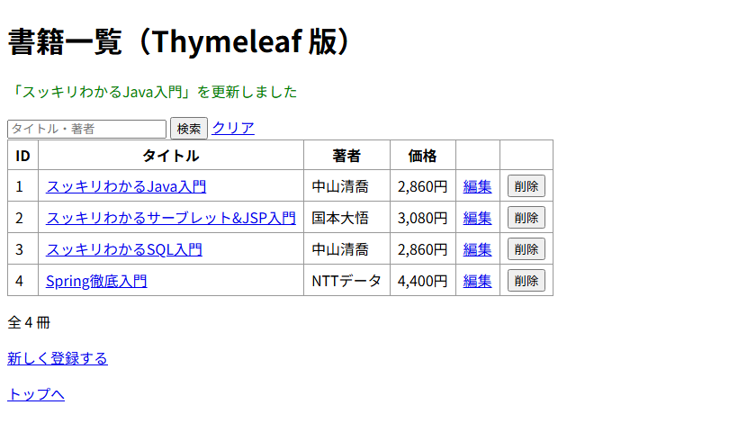
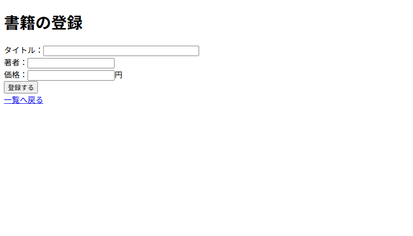
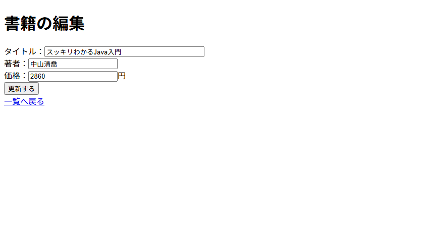
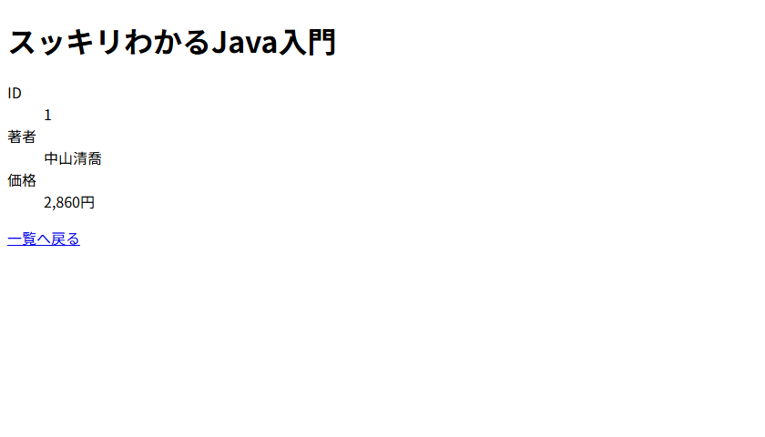

# 書籍のメンテナンス（付録A）画面設計書

画面ごとの設計。URL・Model の詳細は [url-design.md](url-design.md)、テーブルは [table-design.md](table-design.md)、画面のつながりは [screen-flow.md](screen-flow.md) を参照。

## 1. 画面一覧

| 画面ID | 画面名 | URL（url-design の No） | テンプレート |
|---|---|---|---|
| SC-01 | 書籍一覧 | `GET /books`（No.1） | `books.html` |
| SC-02 | 書籍の登録 | `GET /books/new`（No.2） | `book-form.html` |
| SC-03 | 書籍の編集 | `GET /books/{id}/edit`（No.5） | `book-form.html` |
| SC-04 | 書籍の詳細 | `GET /books/{id}`（No.4） | `book-detail.html` |

- SC-02 と SC-03 は同じテンプレートを使い、`book.id` が `null` かどうかで見出し・ボタン名・送信先を切り替える。
- 「見つかりません」の画面はない。存在しない ID のときは SC-01 にリダイレクトする（404 画面はレッスン18）。

## 2. 全画面で共通のルール

| 対象 | ルール |
|---|---|
| 完了メッセージ | 緑の文字（`class="message"`）。フラッシュ属性 `message` があるときだけ表示する |
| 価格 | 3 桁ごとにカンマを入れ、後ろに「円」を付ける（例：`2,860円`）。`#numbers.formatInteger(price, 1, 'COMMA')` |
| 表 | 罫線あり（`border-collapse: collapse`） |
| エラーメッセージ | なし（入力チェックはレッスン18） |

---

## SC-01 書籍一覧

| 項目 | 内容 |
|---|---|
| URL | `GET /books?keyword=...`（`keyword` は省略可。省略時は全件） |
| 役割 | アプリの入口。書籍の一覧を表示し、登録・詳細・編集・削除へ進む |
| Model | `books`、`keyword`、`message` |

### 画面項目

| No | 項目 | 種類 | 表示内容・name | 備考 |
|---|---|---|---|---|
| 1 | 書籍一覧（Thymeleaf 版） | 見出し | 固定 | `<h1>` |
| 2 | 完了メッセージ | メッセージ | `message` | 登録・更新・削除のあとだけ表示 |
| 3 | キーワード | 入力（テキスト） | name=`keyword` | プレースホルダ「タイトル・著者」。検索後も入力値を残す |
| 4 | 検索 | ボタン | ― | `GET /books?keyword=...` を送る |
| 5 | クリア | リンク | ― | `/books`（全件）へ |
| 6 | 書籍の表 | 表 | `books` | 列は下の表。ID 順。0 件のときは表の代わりに「書籍が登録されていません。」 |
| 7 | 件数 | 表示 | `books` の件数 | 「全 N 冊」 |
| 8 | 新しく登録する | リンク | ― | SC-02 へ |
| 9 | トップへ | リンク | ― | `/` へ |

書籍の表の列

| 列 | 表示内容 | 備考 |
|---|---|---|
| ID | `id` | |
| タイトル | `title` | リンク。SC-04 へ |
| 著者 | `author` | |
| 価格 | `price` | `2,860円` の形 |
| （編集） | 「編集」リンク | SC-03 へ |
| （削除） | 「削除」ボタン | `POST /books/{id}/delete`。確認ダイアログ「削除しますか？」で OK のときだけ送信 |

### 操作

| 操作 | 送信 | 結果 |
|---|---|---|
| 「検索」を押す | `GET /books?keyword=...` | タイトルか著者にキーワードを含む書籍を表示 |
| タイトルを押す | `GET /books/{id}` | SC-04 を表示 |
| 「編集」を押す | `GET /books/{id}/edit` | SC-03 を表示 |
| 「削除」を押す | `POST /books/{id}/delete`（No.7） | 削除して SC-01 にリダイレクト。「ID N の書籍を削除しました」 |

- 削除は **リンク（GET）ではなくフォーム（POST）** にする。GET はブラウザの先読みなどでも呼ばれることがあるため。

---

## SC-02 書籍の登録

| 項目 | 内容 |
|---|---|
| URL | `GET /books/new` |
| 役割 | 書籍を 1 冊登録する |
| 初期値 | すべて空 |

### 画面項目

| No | 項目 | 種類 | name | 備考 |
|---|---|---|---|---|
| 1 | 書籍の登録 | 見出し | ― | |
| 2 | タイトル | 入力（テキスト、`size="40"`） | `title` | |
| 3 | 著者 | 入力（テキスト） | `author` | |
| 4 | 価格 | 入力（`type="number"`、`min="0"`）＋「円」 | `price` | |
| 5 | 登録する | ボタン | ― | |
| 6 | 一覧へ戻る | リンク | ― | SC-01 へ |

- 入力欄は `th:object="${book}"` と `th:field="*{title}"` で出力する（`name` と `value` をまとめて出してくれる）。
- 入力チェックはない（レッスン18）。

### 操作

| 操作 | 送信 | 結果 |
|---|---|---|
| 「登録する」を押す | `POST /books`（No.3） | 登録して SC-01 にリダイレクト。「「○○」を登録しました」 |

---

## SC-03 書籍の編集

| 項目 | 内容 |
|---|---|
| URL | `GET /books/{id}/edit` |
| 役割 | 登録済みの書籍を直す |
| 初期値 | DB から読んだ書籍の値 |

### 画面項目

入力欄は SC-02 と同じ。違うところだけ書く。

| No | 項目 | 種類 | 備考 |
|---|---|---|---|
| 1 | 書籍の編集 | 見出し | SC-02 では「書籍の登録」 |
| 2〜4 | タイトル・著者・価格 | 入力 | SC-02 と同じ。値が入った状態で開く |
| 5 | 更新する | ボタン | SC-02 では「登録する」 |
| 6 | 一覧へ戻る | リンク | SC-01 へ |

- 送信先（`th:action`）は、登録なら `/books`、編集なら `/books/1` のように切り替える。

### 操作

| 操作 | 送信 | 結果 |
|---|---|---|
| 「更新する」を押す | `POST /books/{id}`（No.6） | 成功：SC-01 にリダイレクト。「「○○」を更新しました」 ID がない：SC-01 にリダイレクト。「その書籍は見つかりませんでした」 |

---

## SC-04 書籍の詳細

| 項目 | 内容 |
|---|---|
| URL | `GET /books/{id}` |
| 役割 | 1 冊の書籍の内容を見る |
| Model | `book` |

### 画面項目

| No | 項目 | 種類 | 表示内容 | 備考 |
|---|---|---|---|---|
| 1 | タイトル | 見出し | `title` | `<h1>` |
| 2 | ID | 表示 | `id` | `<dl>` で項目名と値を並べる |
| 3 | 著者 | 表示 | `author` | |
| 4 | 価格 | 表示 | `price` | `2,860円` の形 |
| 5 | 一覧へ戻る | リンク | ― | SC-01 へ |

- 存在しない ID のときは、この画面を出さずに SC-01 へリダイレクトする（メッセージなし）。
- 練習問題1で、この画面に「編集」リンクと「削除」ボタンを付ける。
