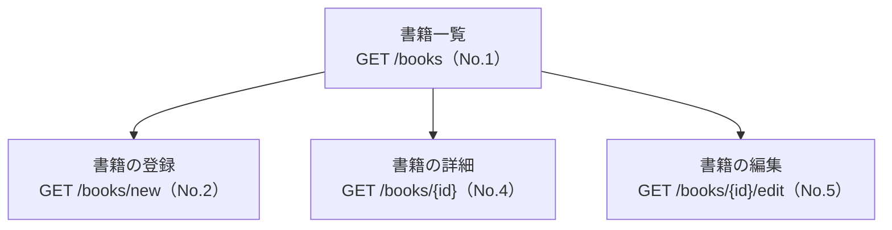
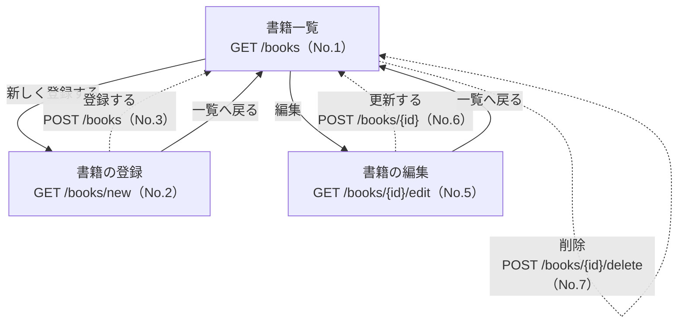
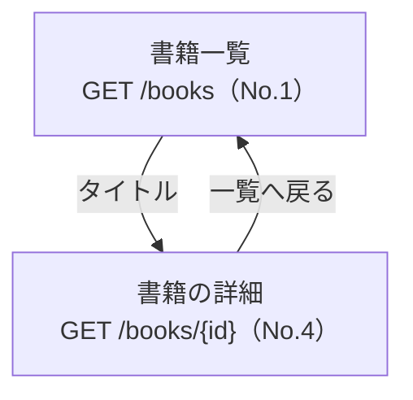
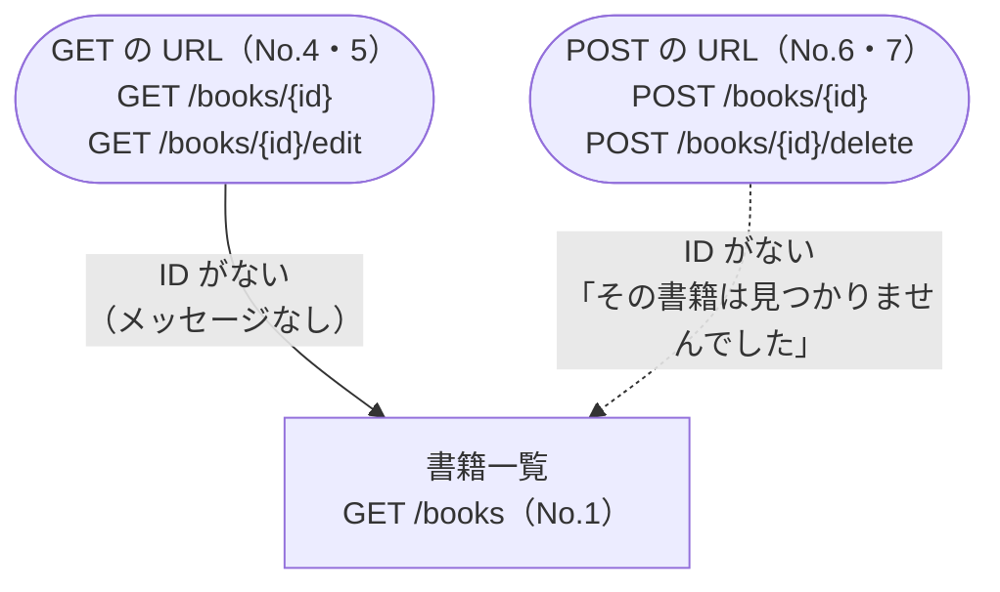

# 書籍のメンテナンス（付録A）画面遷移図

4 画面のつながりを図にしたもの。URL は [url-design.md](url-design.md) の No を付けている。

- 実線の矢印（`-->`）：リンク（GET）で移動する
- 点線の矢印（`-.->`）：フォームを POST して、`redirect:` で移動する
- 付録Aには入力チェックがないので、POST のあとは必ず一覧へリダイレクトする
- 角の丸い箱はリクエスト（画面ではない）

## 1. 全体図

一覧（`/books`）が入口。ここから登録・詳細・編集に分かれる。

## 2. 書籍の登録・編集・削除

- 削除はブラウザの確認ダイアログ（`confirm`）で「OK」を押したときだけ送信する。

---

## 3. 書籍の詳細

---

## 4. 見つからないとき

URL の ID が DB にないときは、専用の画面を出さず **一覧へリダイレクトする**（GET から来たときは実線、POST から来たときは点線で書いている）。404 画面と `@ControllerAdvice` はレッスン18で扱う。

