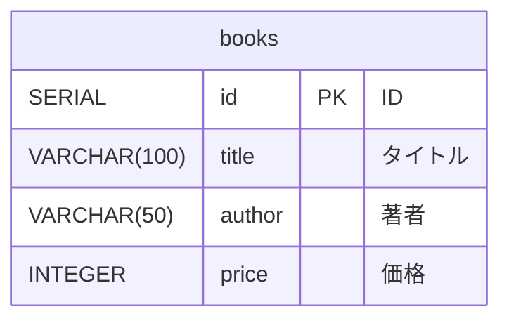

# 書籍のメンテナンス（付録A）テーブル設計書

## 1. テーブル一覧

| No | テーブル名 | 論理名 | 内容 |
|---|---|---|---|
| 1 | `books` | 書籍 | 書籍を 1 冊 1 行で記録する |



- テーブルはレッスン11で作ったものをそのまま使う。付録Aではテーブルを変えない。
- 付録Aで増えるのは、このテーブルへの **書き込み**（`INSERT` / `UPDATE` / `DELETE`）の SQL である。

## 2. テーブル定義

### 2-1. `books`（書籍）

| No | カラム名 | 論理名 | 型 | NULL | 制約 | Java のフィールド | 説明 |
|---|---|---|---|---|---|---|---|
| 1 | `id` | ID | `SERIAL` | × | 主キー | `Integer id` | 書籍を区別する番号。DB が自動で振る |
| 2 | `title` | タイトル | `VARCHAR(100)` | × | | `String title` | 書籍のタイトル |
| 3 | `author` | 著者 | `VARCHAR(50)` | × | | `String author` | 著者名 |
| 4 | `price` | 価格 | `INTEGER` | × | | `Integer price` | 価格（円） |

`model/Book.java`（レッスン12）がこのテーブルの 1 行に対応する。

### ポイント

- **`SERIAL`**：`INSERT` の列に `id` を書かなければ、DB が次の番号を振る。
- **`NOT NULL`**：入力チェックがないので、価格を空で送ると DB がエラーにする（タイトル・著者は空文字 `''` になるので登録できてしまう）。
- **1行 → `Book` の変換**：`RowMapper<Book>` を自分で書き、`findAll` と `findById` で共通に使う。

## 3. DDL（`src/main/resources/schema.sql`）

```sql
-- レッスン11：書籍テーブル
CREATE TABLE IF NOT EXISTS books (
    id     SERIAL PRIMARY KEY,
    title  VARCHAR(100) NOT NULL,
    author VARCHAR(50)  NOT NULL,
    price  INTEGER      NOT NULL
);
```

## 4. 初期データ（`src/main/resources/data.sql`）

```sql
-- レッスン11：サンプルデータ（テーブルが空のときだけ入れる）
INSERT INTO books (title, author, price)
SELECT * FROM (VALUES
    ('スッキリわかるJava入門', '中山清喬', 2860),
    ('スッキリわかるサーブレット&JSP入門', '国本大悟', 3080),
    ('スッキリわかるSQL入門', '中山清喬', 2860),
    ('Spring徹底入門', 'NTTデータ', 4400)
) AS v(title, author, price)
WHERE NOT EXISTS (SELECT 1 FROM books);
```

- `WHERE NOT EXISTS ...` で、再起動のたびにデータが増えるのを防ぐ。
- `application.properties` の `spring.sql.init.mode=always` で、起動時に `schema.sql` と `data.sql` が実行される。

## 5. 画面ごとの SQL

すべて `repository/BookRepository.java` に書く（コントローラに SQL を書かない）。

| URL 設計 No | 処理 | メソッド | SQL |
|---|---|---|---|
| 1 | 全件 | `findAll()` | `SELECT id, title, author, price FROM books ORDER BY id` |
| 1 | キーワード検索 | `findByKeyword(keyword)` | `SELECT id, title, author, price FROM books WHERE title LIKE ? OR author LIKE ? ORDER BY id` |
| 3 | 登録 | `insert(book)` | `INSERT INTO books (title, author, price) VALUES (?, ?, ?)` |
| 4・5 | 1 件取得 | `findById(id)` | `SELECT id, title, author, price FROM books WHERE id = ?` |
| 6 | 更新 | `update(book)` | `UPDATE books SET title = ?, author = ?, price = ? WHERE id = ?` |
| 7 | 削除 | `deleteById(id)` | `DELETE FROM books WHERE id = ?` |

- 読み出し（`SELECT`）は `jdbcTemplate.query(...)`、書き込み（`INSERT` / `UPDATE` / `DELETE`）は `jdbcTemplate.update(...)` を使う。
- `update(sql, 値1, 値2, ...)` の値は `?` に **前から順番に** 入る。`UPDATE` では `WHERE id = ?` が最後なので、`book.getId()` も最後に渡す。
- キーワード検索では、`?` に `"%" + keyword + "%"` を 2 回渡す。値は必ず `?` で渡し、文字列連結しない。

## 6. 補足

- `update()` の戻り値は「変更された行数」。更新・削除で 0 なら、その ID は存在しない。
- `findById` は `query(...).stream().findFirst()` で `Optional<Book>` を返す（見つからなければ空）。
- 教科書の DAO との対応：`PreparedStatement` の作成・`setString`・`executeUpdate`・`close` が、すべて `jdbcTemplate.update` の 1 行に入っている。
