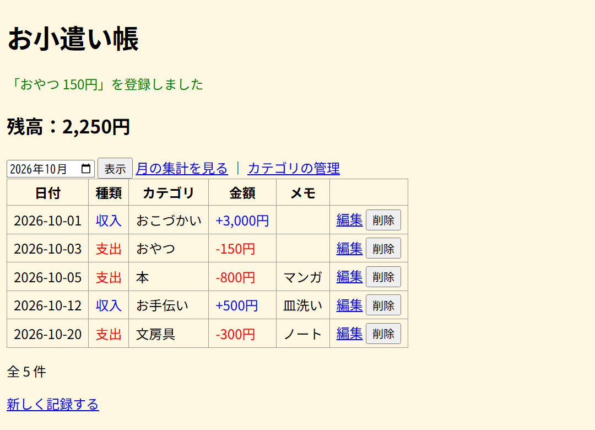
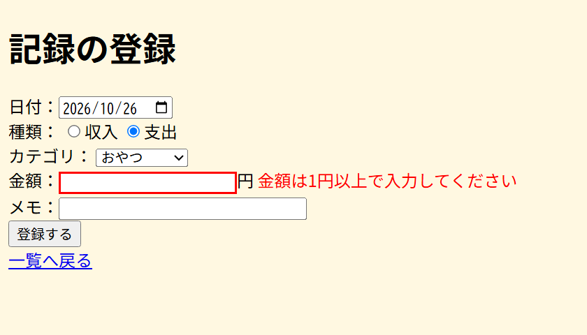
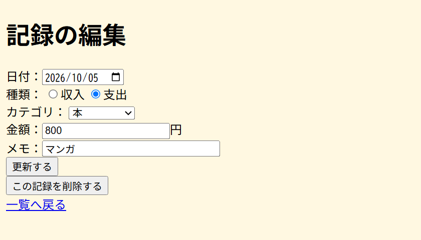
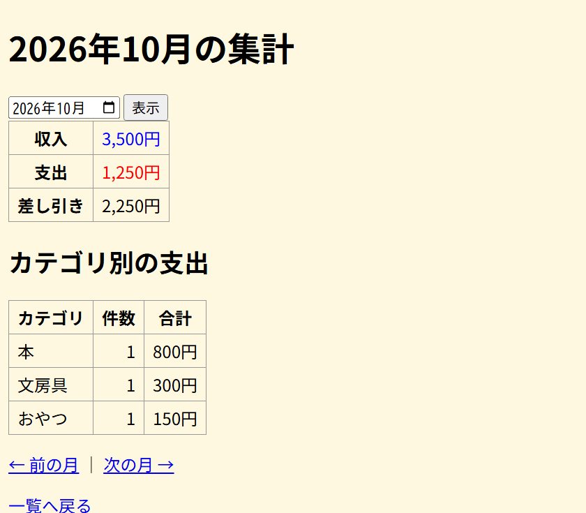
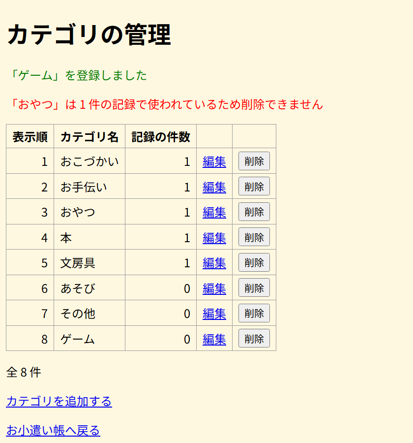
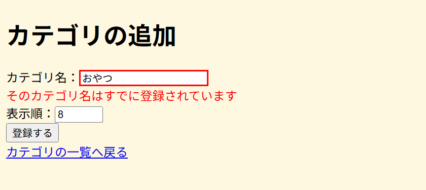
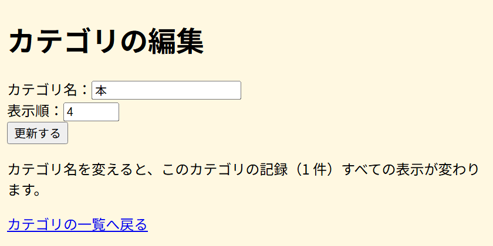
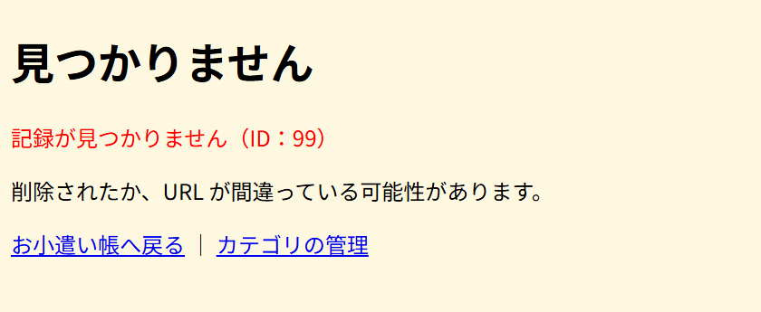

# お小遣い帳（pocket-money）画面設計書

`mock/` の HTML から起こした画面ごとの設計。URL・Model の詳細は [url-design.md](url-design.md)、テーブルは [table-design.md](table-design.md)、画面のつながりは [screen-flow.md](screen-flow.md) を参照。

## 1. 画面一覧

| 画面ID | 画面名 | URL（url-design の No） | テンプレート | モック |
|---|---|---|---|---|
| SC-01 | 一覧・残高 | `GET /pocket`（No.1） | `pocket/list.html` | `mock/index.html` |
| SC-02 | 記録の登録 | `GET /pocket/new`（No.2） | `pocket/form.html` | `mock/new.html` |
| SC-03 | 記録の編集 | `GET /pocket/{id}/edit`（No.4） | `pocket/form.html` | `mock/edit.html` |
| SC-04 | 月の集計 | `GET /pocket/summary`（No.7） | `pocket/summary.html` | `mock/summary.html` |
| SC-05 | カテゴリの一覧 | `GET /categories`（No.8） | `category/list.html` | `mock/categories.html` |
| SC-06 | カテゴリの追加 | `GET /categories/new`（No.9） | `category/form.html` | `mock/category-new.html` |
| SC-07 | カテゴリの編集 | `GET /categories/{id}/edit`（No.11） | `category/form.html` | `mock/category-edit.html` |
| SC-08 | 見つかりません（404） | No.4〜6、11〜13 で ID が存在しないとき | `pocket/not-found.html` | `mock/not-found.html` |

- SC-02 と SC-03、SC-06 と SC-07 は同じテンプレートを使い、見出し・ボタン名・送信先だけを切り替える。
- SC-08 は URL を持たない。存在しない ID が来たとき、どの URL からでもこの画面をステータス 404 で返す。

## 2. 全画面で共通のルール

| 対象 | ルール |
|---|---|
| 背景 | 明るいクリーム色（`#fff8e1`） |
| 完了メッセージ | 緑の文字（`class="message"`）。フラッシュ属性 `message` があるときだけ表示する |
| エラーメッセージ | 赤の文字（`class="error"`）。入力欄は赤い枠（`class="is-error"`）にする |
| 金額 | 3 桁ごとにカンマを入れ、後ろに「円」を付ける（例：`3,000円`） |
| 収入・支出の色 | 収入は青（`class="income"`）、支出は赤（`class="expense"`） |
| 日付 | `yyyy-MM-dd` で表示する（例：`2026-10-05`） |
| 表の数値 | 右寄せ（`class="num"`） |

---

## SC-01 一覧・残高

| 項目 | 内容 |
|---|---|
| URL | `GET /pocket?month=yyyy-MM`（`month` は省略可。省略時は今月） |
| 役割 | アプリの入口。指定した月の記録と、全期間の残高を表示する |
| Model | `entries`、`balance`、`month`、`message` |

### 画面項目

| No | 項目 | 種類 | 表示内容・name | 備考 |
|---|---|---|---|---|
| 1 | お小遣い帳 | 見出し | 固定 | `<h1>` |
| 2 | 完了メッセージ | メッセージ | `message` | 登録・更新・削除のあとだけ表示 |
| 3 | 残高 | 表示 | `balance` | **全期間**の収入合計 − 支出合計。表示する月には関係ない |
| 4 | 表示する月 | 入力（`type="month"`） | name=`month` | 初期値は表示中の月 |
| 5 | 表示 | ボタン | ― | `GET /pocket?month=...` を送る |
| 6 | 月の集計を見る | リンク | ― | SC-04 へ |
| 7 | カテゴリの管理 | リンク | ― | SC-05 へ |
| 8 | 記録の表 | 表 | `entries` | 列は下の表。日付の昇順、同じ日付は ID 順 |
| 9 | 件数 | 表示 | `entries` の件数 | 「全 N 件」 |
| 10 | 新しく記録する | リンク | ― | SC-02 へ |

記録の表の列

| 列 | 表示内容 | 備考 |
|---|---|---|
| 日付 | `entryDate` | |
| 種類 | `type` | 収入は青、支出は赤 |
| カテゴリ | `categoryName` | `categories` と JOIN して取る |
| 金額 | `amount` | 収入は `+3,000円`（青）、支出は `-150円`（赤） |
| メモ | `memo` | 空なら何も出さない |
| 操作 | 「編集」リンク、「削除」ボタン | 編集は SC-03 へ。削除は `POST /pocket/{id}/delete` |

### 操作

| 操作 | 送信 | 結果 |
|---|---|---|
| 「表示」を押す | `GET /pocket?month=yyyy-MM` | その月の一覧を表示 |
| 「編集」を押す | `GET /pocket/{id}/edit` | SC-03 を表示 |
| 「削除」を押す | `POST /pocket/{id}/delete`（No.6） | 削除して SC-01 にリダイレクト。「○○ ○○円を削除しました」 |

---

## SC-02 記録の登録

| 項目 | 内容 |
|---|---|
| URL | `GET /pocket/new` |
| 役割 | 収入・支出を 1 件登録する |
| 初期値 | 日付は今日、種類は「支出」 |
| モックの状態 | 金額を入れずに「登録する」を押して、エラーになったところ |

### 画面項目

| No | 項目 | 種類 | name | チェック | エラーメッセージ |
|---|---|---|---|---|---|
| 1 | 記録の登録 | 見出し | ― | | |
| 2 | 日付 | 入力（`type="date"`） | `entryDate` | 必須 | 日付を入力してください |
| 3 | 種類 | ラジオボタン（収入・支出） | `type` | 必須 | 種類を選んでください |
| 4 | カテゴリ | セレクトボックス | `categoryId` | 必須 | カテゴリを選んでください |
| 5 | 金額 | 入力（テキスト）＋「円」 | `amount` | 必須、1〜1,000,000 | 金額は1円以上で入力してください |
| 6 | メモ | 入力（テキスト、`size="30"`） | `memo` | 100文字以内 | メモは100文字以内で入力してください |
| 7 | 登録する | ボタン | ― | | |
| 8 | 一覧へ戻る | リンク | ― | | SC-01 へ |

- カテゴリの選択肢は `categories` テーブルから表示順（`sort_order`）で取る。値はカテゴリ ID、表示はカテゴリ名。
- エラーは入力欄のすぐ後ろに赤で出し、入力欄を赤枠にする。入力した値は消さない。

### 操作

| 操作 | 送信 | 結果 |
|---|---|---|
| 「登録する」を押す | `POST /pocket`（No.3） | 成功：SC-01 にリダイレクト。「○○ ○○円を登録しました」 エラー：SC-02 をエラー付きで再表示 |

---

## SC-03 記録の編集

| 項目 | 内容 |
|---|---|
| URL | `GET /pocket/{id}/edit` |
| 役割 | 登録済みの記録を直す・消す |
| 初期値 | DB から読んだ記録の値 |
| モックの状態 | id=3（2026-10-05 本 800円 マンガ）を開いたところ |

### 画面項目

入力欄とチェックは SC-02 と同じ。違うところだけ書く。

| No | 項目 | 種類 | 備考 |
|---|---|---|---|
| 1 | 記録の編集 | 見出し | SC-02 では「記録の登録」 |
| 2〜6 | 日付・種類・カテゴリ・金額・メモ | 入力 | SC-02 と同じ。値が入った状態で開く |
| 7 | 更新する | ボタン | SC-02 では「登録する」 |
| 8 | この記録を削除する | ボタン | 編集のときだけ表示。別の `<form>` にする |
| 9 | 一覧へ戻る | リンク | SC-01 へ |

### 操作

| 操作 | 送信 | 結果 |
|---|---|---|
| 「更新する」を押す | `POST /pocket/{id}`（No.5） | 成功：SC-01 にリダイレクト。「○○ ○○円に更新しました」 エラー：SC-03 をエラー付きで再表示 |
| 「この記録を削除する」を押す | `POST /pocket/{id}/delete`（No.6） | 削除して SC-01 にリダイレクト。「○○ ○○円を削除しました」 |

---

## SC-04 月の集計

| 項目 | 内容 |
|---|---|
| URL | `GET /pocket/summary?month=yyyy-MM`（`month` は省略可。省略時は今月） |
| 役割 | 1 か月の収入・支出の合計と、カテゴリ別の支出を見る |
| Model | `month`、`incomeTotal`、`expenseTotal`、`difference`、`categoryTotals`、`prevMonth`、`nextMonth` |
| モックの状態 | 2026 年 10 月 |

### 画面項目

| No | 項目 | 種類 | 表示内容・name | 備考 |
|---|---|---|---|---|
| 1 | yyyy年M月の集計 | 見出し | `month` | 例：「2026年10月の集計」 |
| 2 | 表示する月 | 入力（`type="month"`） | name=`month` | 初期値は表示中の月 |
| 3 | 表示 | ボタン | ― | `GET /pocket/summary?month=...` を送る |
| 4 | 収入 | 表示 | `incomeTotal` | 青 |
| 5 | 支出 | 表示 | `expenseTotal` | 赤 |
| 6 | 差し引き | 表示 | `difference` | 収入 − 支出 |
| 7 | カテゴリ別の支出 | 見出し | 固定 | `<h2>` |
| 8 | カテゴリ別の表 | 表 | `categoryTotals` | 列はカテゴリ・件数・合計。合計の多い順。支出だけを数える |
| 9 | ← 前の月 | リンク | `prevMonth` | `/pocket/summary?month=前の月` |
| 10 | 次の月 → | リンク | `nextMonth` | `/pocket/summary?month=次の月` |
| 11 | 一覧へ戻る | リンク | ― | SC-01 へ |

- その月に支出がないときは、カテゴリ別の表は見出し行だけになる。

---

## SC-05 カテゴリの一覧

| 項目 | 内容 |
|---|---|
| URL | `GET /categories` |
| 役割 | カテゴリ（セレクトボックスの選択肢）を管理する |
| Model | `categories`、`message`、`errorMessage` |
| モックの状態 | 完了メッセージと削除エラーを両方出している（実際はどちらか一方） |

### 画面項目

| No | 項目 | 種類 | 表示内容・name | 備考 |
|---|---|---|---|---|
| 1 | カテゴリの管理 | 見出し | 固定 | |
| 2 | 完了メッセージ | メッセージ（緑） | `message` | 登録・更新・削除のあとだけ表示 |
| 3 | 削除エラー | メッセージ（赤） | `errorMessage` | 記録で使われているカテゴリを消そうとしたときだけ表示 |
| 4 | カテゴリの表 | 表 | `categories` | 列は下の表。表示順、同じなら ID 順 |
| 5 | 件数 | 表示 | `categories` の件数 | 「全 N 件」 |
| 6 | カテゴリを追加する | リンク | ― | SC-06 へ |
| 7 | お小遣い帳へ戻る | リンク | ― | SC-01 へ |

カテゴリの表の列

| 列 | 表示内容 | 備考 |
|---|---|---|
| 表示順 | `sortOrder` | 右寄せ |
| カテゴリ名 | `name` | |
| 記録の件数 | `entryCount`（そのカテゴリを使っている記録の数） | 右寄せ。`LEFT JOIN` で数える（0 件のカテゴリも出す） |
| 編集 | リンク | SC-07 へ |
| 削除 | ボタン | `POST /categories/{id}/delete` |

### 操作

| 操作 | 送信 | 結果 |
|---|---|---|
| 「編集」を押す | `GET /categories/{id}/edit` | SC-07 を表示 |
| 「削除」を押す | `POST /categories/{id}/delete`（No.13） | 成功：SC-05 にリダイレクト。「○○を削除しました」 使われている：削除せず SC-05 にリダイレクト。「○○は N 件の記録で使われているため削除できません」 |

---

## SC-06 カテゴリの追加

| 項目 | 内容 |
|---|---|
| URL | `GET /categories/new` |
| 役割 | カテゴリを 1 件追加する |
| 初期値 | 表示順は「今ある表示順の最大値 + 1」 |
| モックの状態 | すでにある「おやつ」を登録しようとして、エラーになったところ |

### 画面項目

| No | 項目 | 種類 | name | チェック | エラーメッセージ |
|---|---|---|---|---|---|
| 1 | カテゴリの追加 | 見出し | ― | | |
| 2 | カテゴリ名 | 入力（テキスト） | `name` | 必須、30文字以内、重複不可 | カテゴリ名を入力してください／カテゴリ名は30文字以内で入力してください／そのカテゴリ名はすでに登録されています |
| 3 | 表示順 | 入力（テキスト、`size="4"`） | `sortOrder` | 必須、0〜999 | 表示順は0〜999で入力してください |
| 4 | 登録する | ボタン | ― | | |
| 5 | カテゴリの一覧へ戻る | リンク | ― | | SC-05 へ |

- エラーは入力欄の下の行に赤で出す。
- 重複チェックは Bean Validation ではできないので、コントローラ（またはサービス）で DB を調べて `BindingResult.rejectValue` で追加する。

### 操作

| 操作 | 送信 | 結果 |
|---|---|---|
| 「登録する」を押す | `POST /categories`（No.10） | 成功：SC-05 にリダイレクト。「○○を登録しました」 エラー：SC-06 をエラー付きで再表示 |

---

## SC-07 カテゴリの編集

| 項目 | 内容 |
|---|---|
| URL | `GET /categories/{id}/edit` |
| 役割 | カテゴリ名・表示順を直す |
| 初期値 | DB から読んだカテゴリの値 |
| モックの状態 | id=4（本）を開いたところ |

### 画面項目

入力欄とチェックは SC-06 と同じ。違うところだけ書く。

| No | 項目 | 種類 | 備考 |
|---|---|---|---|
| 1 | カテゴリの編集 | 見出し | SC-06 では「カテゴリの追加」 |
| 2〜3 | カテゴリ名・表示順 | 入力 | SC-06 と同じ。値が入った状態で開く |
| 4 | 更新する | ボタン | SC-06 では「登録する」 |
| 5 | 注意書き | 表示 | 「カテゴリ名を変えると、このカテゴリの記録（N 件）すべての表示が変わります。」編集のときだけ表示 |
| 6 | カテゴリの一覧へ戻る | リンク | SC-05 へ |

- 名前の重複チェックでは自分自身（同じ ID）は除く。名前を変えずに表示順だけ変えられるようにするため。

### 操作

| 操作 | 送信 | 結果 |
|---|---|---|
| 「更新する」を押す | `POST /categories/{id}`（No.12） | 成功：SC-05 にリダイレクト。「○○に更新しました」 エラー：SC-07 をエラー付きで再表示 |

---

## SC-08 見つかりません（404）

| 項目 | 内容 |
|---|---|
| 表示するとき | No.4〜6（記録）、No.11〜13（カテゴリ）で、URL の ID が DB にないとき |
| ステータス | 404 |
| 役割 | 「見つからない」ことを伝えて、一覧に戻れるようにする |
| Model | `errorMessage` |
| モックの状態 | `GET /pocket/99/edit`（ID=99 の記録はない）を開いたところ |

### 画面項目

| No | 項目 | 種類 | 表示内容・name | 備考 |
|---|---|---|---|---|
| 1 | 見つかりません | 見出し | 固定 | |
| 2 | エラーメッセージ | メッセージ（赤） | `errorMessage` | 記録のとき「記録が見つかりません（ID：N）」 カテゴリのとき「カテゴリが見つかりません（ID：N）」 |
| 3 | 説明 | 表示 | 固定 | 「削除されたか、URL が間違っている可能性があります。」 |
| 4 | お小遣い帳へ戻る | リンク | ― | SC-01 へ |
| 5 | カテゴリの管理 | リンク | ― | SC-05 へ |

- 記録とカテゴリで同じテンプレートを使い、メッセージだけを変える。
- 404 にするには、コントローラで `HttpServletResponse.setStatus(404)` してからこの画面を返すか、「見つからない」例外を作って `@ExceptionHandler` で受け、そのメソッドに `@ResponseStatus(HttpStatus.NOT_FOUND)` を付けてこの画面を返す。
- POST（更新・削除）で ID がないときも、この画面を返す（リダイレクトしない）。
