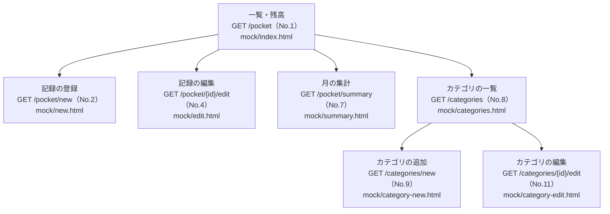
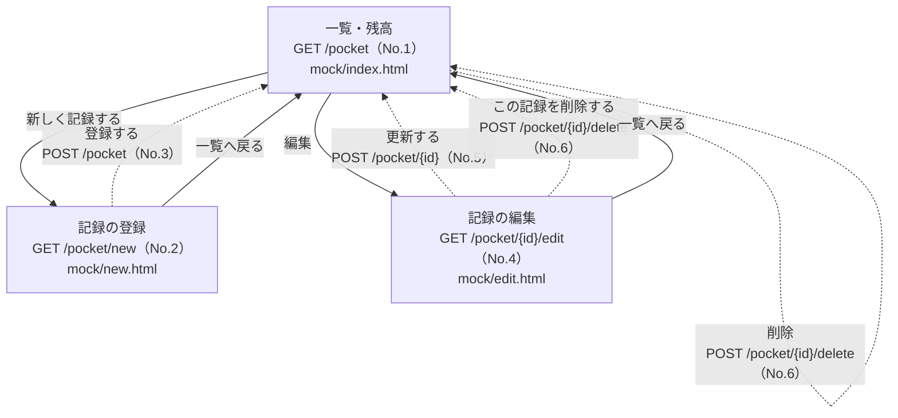
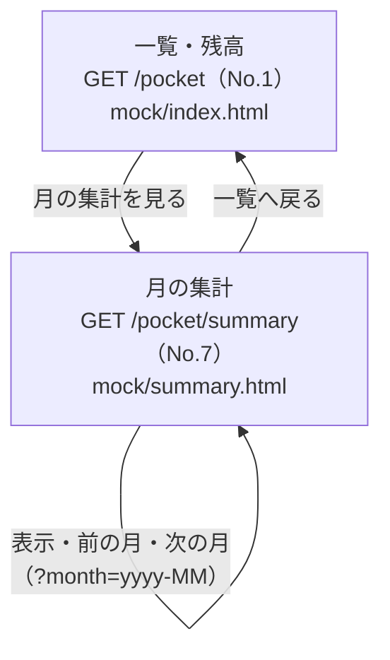
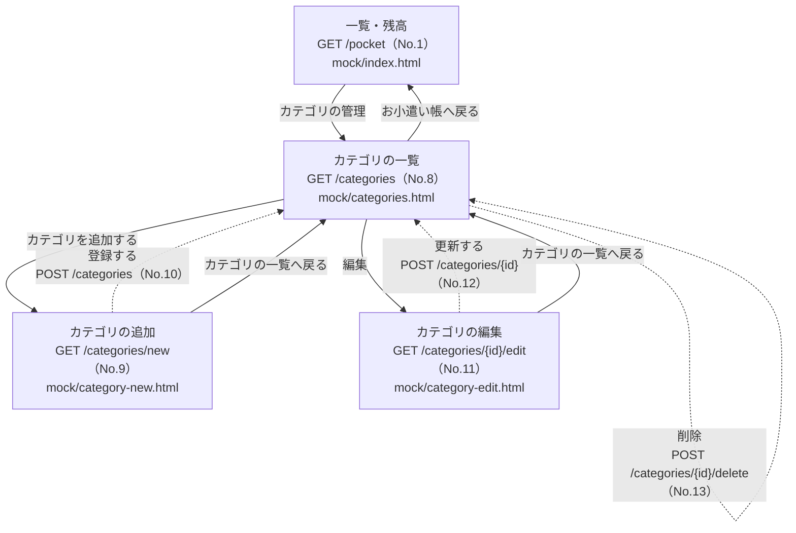
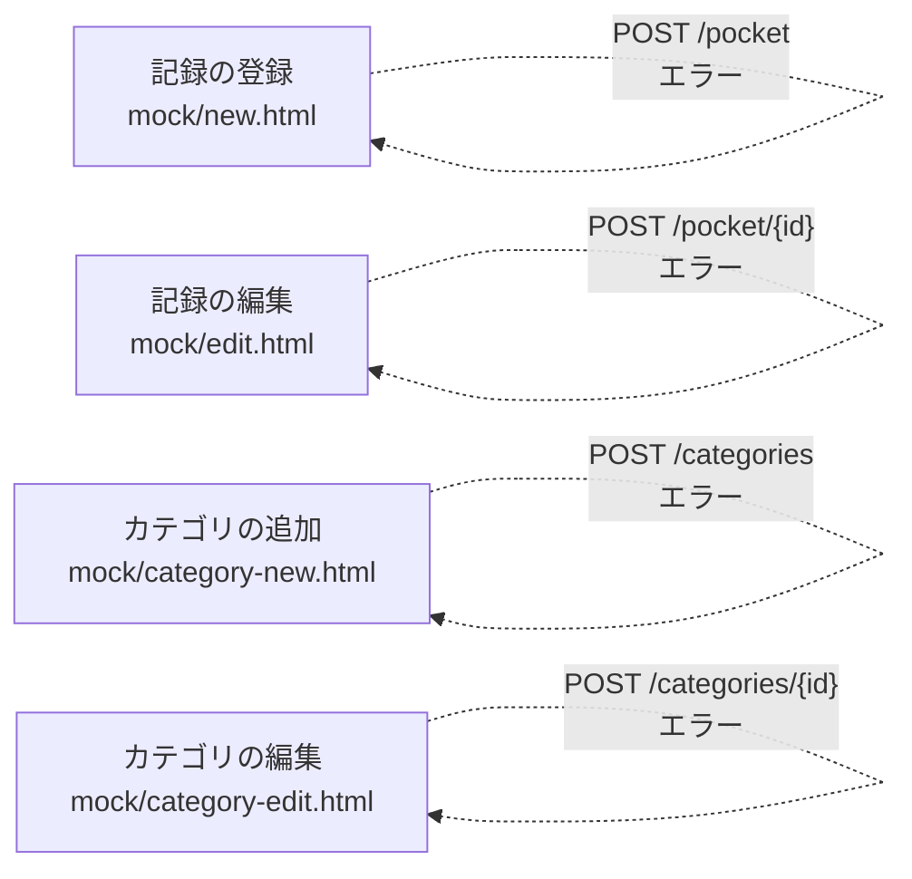
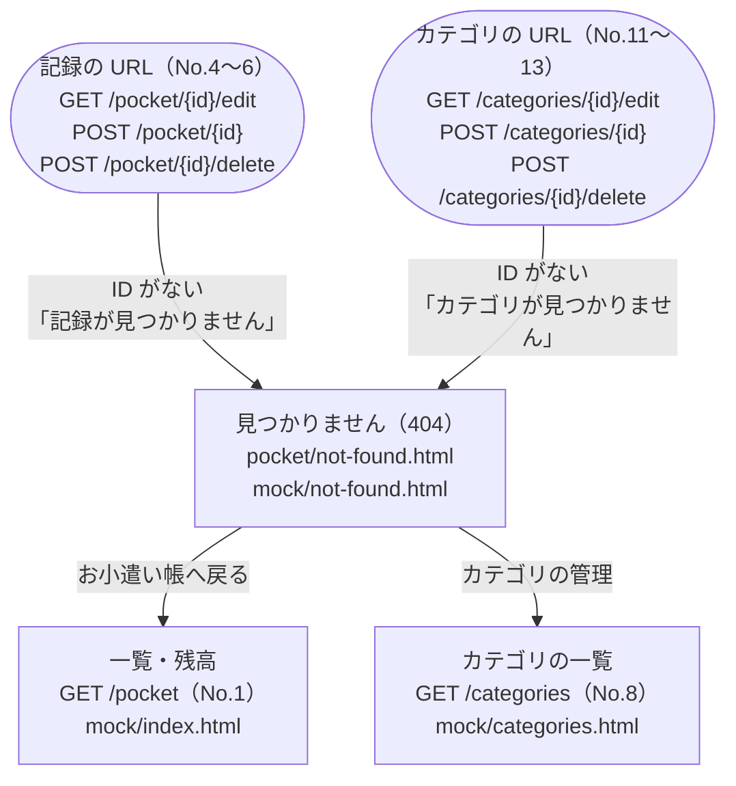

# お小遣い帳（pocket-money）画面遷移図

`mock/` の 8 画面のつながりを図にしたもの。URL は [url-design.md](url-design.md) の No を付けている。

- 実線の矢印（`-->`）：リンク（GET）で移動する
- 点線の矢印（`-.->`）：フォームを POST して、成功したら `redirect:` で移動する
- 入力エラーのときは `redirect` せず、同じフォーム画面をエラー表示付きで返す
- 角の丸い箱はリクエスト（画面ではない）

## 1. 全体図

一覧（`/pocket`）が入口。ここから 3 つの機能に分かれる。

## 2. 記録の登録・編集・削除

---

## 3. 月の集計

## 4. カテゴリの管理

カテゴリが記録で使われているときは削除せずに `redirect:/categories` し、カテゴリの一覧に `errorMessage` を表示する。

---

## 5. 入力エラーのとき

登録・更新でチェックに引っかかったときは、リダイレクトせず同じフォームを返す（入力した値とエラーメッセージが表示される）。

---

## 6. 見つからないとき（404）

URL の ID が DB にないときは、どの URL からでも「見つかりません」の画面をステータス 404 で返す（リダイレクトしない）。削除済みの記録の編集画面をブックマークから開いたときや、URL を直接打ったときに起きる。

