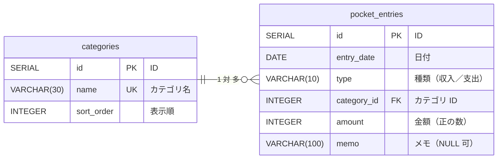

# お小遣い帳（pocket-money）テーブル設計書

## 1. テーブル一覧

| No | テーブル名 | 論理名 | 内容 |
|---|---|---|---|
| 1 | `categories` | カテゴリ | カテゴリの選択肢（マスタ） |
| 2 | `pocket_entries` | お小遣い記録 | 収入・支出を 1 件 1 行で記録する |



- 1 つのカテゴリに、たくさんの記録がつながる（1 対 多）。
- 記録にはカテゴリ名ではなく **カテゴリの ID** を保存する。名前を変えたいときは `categories` の 1 行を直すだけで、すべての記録に反映される。
- 画面にカテゴリ名を出すときは、2 つのテーブルを **JOIN** してつなぐ。
- 残高は保存しない。毎回「収入合計 − 支出合計」で計算する（保存すると、編集・削除のたびに残高の更新が必要になり、ずれの原因になるため）。

## 2. テーブル定義

### 2-1. `categories`（カテゴリ）

| No | カラム名 | 論理名 | 型 | NULL | 制約 | Java のフィールド | 説明 |
|---|---|---|---|---|---|---|---|
| 1 | `id` | ID | `SERIAL` | × | 主キー | `Integer id` | カテゴリを区別する番号 |
| 2 | `name` | カテゴリ名 | `VARCHAR(30)` | × | 一意（UNIQUE） | `String name` | 画面に表示する名前 |
| 3 | `sort_order` | 表示順 | `INTEGER` | × | | `Integer sortOrder` | セレクトボックスに並べる順番 |

### 2-2. `pocket_entries`（お小遣い記録）

| No | カラム名 | 論理名 | 型 | NULL | 制約 | Java のフィールド | 説明 |
|---|---|---|---|---|---|---|---|
| 1 | `id` | ID | `SERIAL` | × | 主キー | `Integer id` | 記録を区別する番号 |
| 2 | `entry_date` | 日付 | `DATE` | × | | `LocalDate entryDate` | お金が動いた日 |
| 3 | `type` | 種類 | `VARCHAR(10)` | × | `'収入'` か `'支出'` のみ | `String type` | 収入か支出か |
| 4 | `category_id` | カテゴリ ID | `INTEGER` | × | 外部キー → `categories(id)` | `Integer categoryId` | どのカテゴリの記録か |
| 5 | `amount` | 金額 | `INTEGER` | × | 1〜1,000,000 | `Integer amount` | **常に正の数**。収入か支出かは `type` で区別する |
| 6 | `memo` | メモ | `VARCHAR(100)` | ○ | | `String memo` | 自由に書けるメモ（空でもよい） |

一覧・編集画面ではカテゴリ名も必要なので、記録のクラスには JOIN で取ってきた `String categoryName` も持たせる（テーブルのカラムではない）。

### ポイント

- **外部キー（FOREIGN KEY）**：`categories` に無い ID は `category_id` に入れられない。また、記録から使われているカテゴリは削除できない（記録がカテゴリ無しで残るのを防ぐ）。
- **金額をマイナスで保存しない**：支出も `800` のように正の数で保存する。画面の「-800円」は表示のときに付ける。
- **カラム名はスネークケース、Java はキャメルケース**：`category_id` ⇔ `categoryId`。`BeanPropertyRowMapper` が自動で対応づける。JOIN で取ったカテゴリ名は `c.name AS category_name` と別名を付けると `categoryName` に入る。

### インデックス

| インデックス名 | カラム | 目的 |
|---|---|---|
| （主キー・UNIQUE） | `id`、`categories.name` | 自動で作られる |
| `idx_pocket_entries_entry_date` | `entry_date` | 一覧・集計の「月で絞り込む」検索を速くする |
| `idx_pocket_entries_category_id` | `category_id` | JOIN を速くする（PostgreSQL は外部キーに自動ではインデックスを作らない） |

## 3. DDL（`src/main/resources/schema.sql`）

`pocket_entries` が `categories` を参照するので、**`categories` を先に作る**。

```sql
CREATE TABLE IF NOT EXISTS categories (
    id         SERIAL PRIMARY KEY,
    name       VARCHAR(30) NOT NULL UNIQUE,
    sort_order INTEGER     NOT NULL
);

CREATE TABLE IF NOT EXISTS pocket_entries (
    id          SERIAL PRIMARY KEY,
    entry_date  DATE         NOT NULL,
    type        VARCHAR(10)  NOT NULL CHECK (type IN ('収入', '支出')),
    category_id INTEGER      NOT NULL REFERENCES categories (id),
    amount      INTEGER      NOT NULL CHECK (amount BETWEEN 1 AND 1000000),
    memo        VARCHAR(100)
);

CREATE INDEX IF NOT EXISTS idx_pocket_entries_entry_date
    ON pocket_entries (entry_date);
CREATE INDEX IF NOT EXISTS idx_pocket_entries_category_id
    ON pocket_entries (category_id);
```

## 4. 初期データ（`src/main/resources/data.sql`）

```sql
INSERT INTO categories (name, sort_order) VALUES
    ('おこづかい', 1),
    ('お手伝い',   2),
    ('おやつ',     3),
    ('本',         4),
    ('文房具',     5),
    ('あそび',     6),
    ('その他',     7)
ON CONFLICT (name) DO NOTHING;

INSERT INTO pocket_entries (entry_date, type, category_id, amount, memo)
SELECT v.entry_date, v.type, c.id, v.amount, v.memo
FROM (VALUES
    (DATE '2026-10-01', '収入', 'おこづかい', 3000, NULL),
    (DATE '2026-10-03', '支出', 'おやつ',      150, NULL),
    (DATE '2026-10-05', '支出', '本',          800, 'マンガ'),
    (DATE '2026-10-12', '収入', 'お手伝い',    500, '皿洗い'),
    (DATE '2026-10-20', '支出', '文房具',      300, 'ノート')
) AS v (entry_date, type, category_name, amount, memo)
JOIN categories c ON c.name = v.category_name
WHERE NOT EXISTS (SELECT 1 FROM pocket_entries);
```

- カテゴリは `ON CONFLICT (name) DO NOTHING`、記録は `WHERE NOT EXISTS ...` で、再起動のたびにデータが増えるのを防ぐ。
- 記録の `category_id` は ID を直接書かず、カテゴリ名で JOIN して取ってくる（ID の番号に依存しない）。
- 確認：収入 3,500 − 支出 1,250 = 残高 **2,250円**（モックと一致）。

## 5. 画面ごとの SQL

| URL 設計 No | 処理 | SQL |
|---|---|---|
| 1 | 指定月の一覧 | 下の「JOIN の例」を参照 |
| 1 | 残高（全期間） | `SELECT COALESCE(SUM(CASE WHEN type = '収入' THEN amount ELSE -amount END), 0) FROM pocket_entries` |
| 2・4 | カテゴリの選択肢 | `SELECT * FROM categories ORDER BY sort_order` |
| 3 | 登録 | `INSERT INTO pocket_entries (entry_date, type, category_id, amount, memo) VALUES (?, ?, ?, ?, ?)` |
| 3・5 | メッセージ用のカテゴリ名 | `SELECT name FROM categories WHERE id = ?` |
| 4 | 1 件取得 | 一覧と同じ JOIN で `WHERE e.id = ?` |
| 5 | 更新 | `UPDATE pocket_entries SET entry_date = ?, type = ?, category_id = ?, amount = ?, memo = ? WHERE id = ?` |
| 6 | 削除 | `DELETE FROM pocket_entries WHERE id = ?` |
| 7 | 月の収入・支出合計 | `SELECT type, SUM(amount) FROM pocket_entries WHERE entry_date >= ? AND entry_date < ? GROUP BY type` |
| 7 | カテゴリ別の支出 | 下の「JOIN ＋ GROUP BY の例」を参照 |

### JOIN の例（No.1 一覧）

```sql
SELECT e.id, e.entry_date, e.type, e.category_id, c.name AS category_name, e.amount, e.memo
FROM pocket_entries e
JOIN categories c ON c.id = e.category_id
WHERE e.entry_date >= ? AND e.entry_date < ?
ORDER BY e.entry_date, e.id
```

- `e`・`c` はテーブルの別名。両方のテーブルに `id` があるので、どちらの `id` かを `e.id` のように書き分ける。
- `ON c.id = e.category_id` が「どの行とどの行をつなぐか」の条件。

### JOIN ＋ GROUP BY の例（No.7 カテゴリ別の支出）

```sql
SELECT c.name AS category, COUNT(*) AS count, SUM(e.amount) AS total
FROM pocket_entries e
JOIN categories c ON c.id = e.category_id
WHERE e.type = '支出' AND e.entry_date >= ? AND e.entry_date < ?
GROUP BY c.id, c.name
ORDER BY total DESC
```

## 6. カテゴリのメンテナンスの SQL

| URL 設計 No | 処理 | SQL |
|---|---|---|
| 8 | 一覧（記録の件数つき） | 下の「LEFT JOIN の例」を参照 |
| 9 | 表示順の初期値 | `SELECT COALESCE(MAX(sort_order), 0) + 1 FROM categories` |
| 10 | 登録 | `INSERT INTO categories (name, sort_order) VALUES (?, ?)` |
| 10・12 | 名前の重複チェック | `SELECT COUNT(*) FROM categories WHERE name = ? AND id <> ?`（登録のときは id に 0 を渡す） |
| 11 | 1 件取得 | `SELECT * FROM categories WHERE id = ?` |
| 12 | 更新 | `UPDATE categories SET name = ?, sort_order = ? WHERE id = ?` |
| 13 | 使われている件数 | `SELECT COUNT(*) FROM pocket_entries WHERE category_id = ?` |
| 13 | 削除 | `DELETE FROM categories WHERE id = ?` |

### LEFT JOIN の例（No.8 カテゴリの一覧）

```sql
SELECT c.id, c.name, c.sort_order, COUNT(e.id) AS entry_count
FROM categories c
LEFT JOIN pocket_entries e ON e.category_id = c.id
GROUP BY c.id, c.name, c.sort_order
ORDER BY c.sort_order, c.id
```

- `JOIN`（内部結合）だと、記録が 1 件もないカテゴリ（「あそび」など）が一覧から消えてしまう。`LEFT JOIN` は左側（`categories`）の行を必ず残す。
- 記録がないカテゴリは `e` の列がすべて `NULL` になるので、`COUNT(*)` ではなく `COUNT(e.id)` で数える（`NULL` は数えられず 0 になる）。

## 7. 補足

- 月の絞り込みは「月初 ≦ 日付 ＜ 翌月初」で書く（`YearMonth` の `atDay(1)` と `plusMonths(1).atDay(1)`）。月末日を気にしなくてよい。
- 更新・削除で `update()` の戻り値（変更された行数）が 0 なら、その ID は存在しない → 404。
- 記録が 1 件もないと `SUM` は `NULL` になるので、残高は `COALESCE(..., 0)` で 0 にする。
